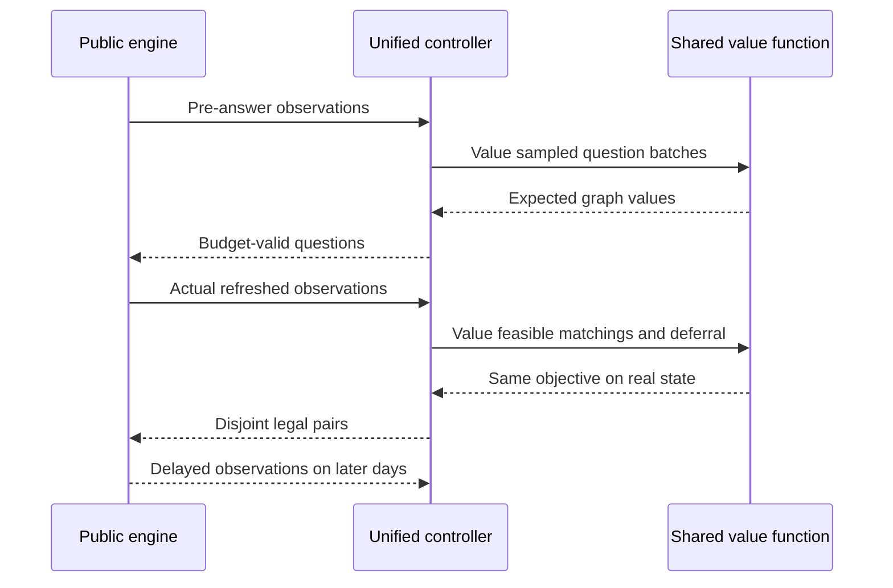

# Coordinated policy: a single observable-state planning objective

The original architecture used input/pruned question rules, a separate agreement or ML tie-break score, greedy allocation and optional waiting thresholds. Those mechanisms did not share a full-game value estimate. Keeping a baseline active after failed promotion was appropriate release discipline; it was not evidence that the trained model controlled the deployed policy.

The new `coordinated` candidate has one trained reward model, one hold-time model and one planning objective. The original baseline and research evidence remain intact. There are two public top-level choices: `conservative` and `coordinated`. Two evaluation-only controls remove continuation value or learned estimates; they are component ablations, not additional candidates selected from the final results.

## Value definition

For an available pair, the clean 32-feature model estimates recorded mutual second-intention success including late responses. A training-only empirical timeliness factor converts that estimate to an official-success proxy. A separate ridge head estimates the observed scheduled-hold proxy in days. These are estimates on selected historical introductions, not population probabilities or hidden true availability.

Let `p(i,j)` be that official-success estimate, `d(i,j)` the hold proxy and `H = 60 - day`. Each member's continuation rate is the best current incident `p / (2*d + 1)`; zero if no opportunity exists. This allocates half of an approximate recurring pair reward rate to each endpoint. It does not know future arrivals or permit repeating a real introduction.

The planner maximizes the approximation:

`V(state, M) = sum(p(i,j) for selected introductions) + sum((H - selected_busy_days(i)) * rate(i))`

Here busy days are capped at H, and are zero for members left available. This is equivalent to matching on the net increment `p(i,j) - min(H,d(i,j))*(rate(i)+rate(j))` above the wait value. Nonpositive increments defer an edge. There is no independent wait-age threshold, acceptance-only ranking or question-specific reward coefficient.

The continuation term is essential when valuing new disclosures: adding options can raise rates, so comparing only matching increments would incorrectly penalize information. The complete value includes both continuation and matching. Unit checks cover the nondecreasing value of added disclosed options and shrinking opportunity costs near the decision horizon.

## Two-phase execution

The controller and value function run locally in one policy process. Sampled answers are discarded before the real match phase.

## Questions and allocation

1. Build observable potential edges. Known hard failures, repeat introductions, unavailable members and declined hard fields are excluded.
2. Estimate pair reward and hold using the same point-in-time feature transform used in training. No member ID or world seed is a model feature.
3. Value complete question batches, including complementary endpoint bundles. Three common empirical hard-answer scenarios estimate changes to the same graph-planning value. A Beta(1,1) prior is updated only from observed constraint-ask completion logs. The inherited deterministic sampler uses `17:day:sample:member`; `coordinated-answer-v1` is the protocol's sampler version label.
4. Respect the 12-unit public ask budget. Hard-question batches cost three per member. A 12-bundle reward-based shortlist bounds work; this proposal score is not an upper bound on information value and can discard useful batches. The final comparison uses full sampled graph value. Empty asking remains an option.
5. After actual answers, discard all hypothetical profiles and rebuild from the engine's refreshed observation. Match only genuinely disclosed feasible edges. A deterministic greedy incumbent and at most two improving exchange passes handle endpoint competition. This is a bounded general-graph approximation, not an exact global optimizer.

Asking uses no future truth. The shared graph objective accounts for displaced matching opportunities and modeled future availability. Model estimates directly determine the candidate's question values, matching increments and deferral; they are not limited to tie-breaking.

## What is and is not addressed

| Concern | Concrete change | Remaining limit |
| --- | --- | --- |
| Separate local objectives | Asking, matching and deferral share V | Candidate-generation screen and bounded search can miss good plans |
| Endpoint competition | Full matching value and improving exchanges | No exact optimum guarantee |
| Cascading early errors | Replan from real disclosures every decision; hypothetical answers never enter real matching | Early actions remain irreversible and can still hurt |
| Weak model integration | Absolute learned success/hold estimates drive the whole candidate | Active policy changes only after full-game and runtime gates |
| Horizon effects | Explicit remaining horizon and busy-time continuation charge | No complete 60-day rollout, future-arrival forecast or learned Bellman value |
| Heuristic sprawl | One candidate/configuration, two declared component ablations and a two-mode top-level CLI | Historical controls are retained only for reproducible research |

The common objective makes decisions internally consistent. It is not proof of more MSMI. The continuation estimate can be optimistic, answer donors can be unrepresentative, the complete-answer response model is coarse, and training labels are selected by older logging policies. Full-game comparisons, service outcomes and frozen promotion gates decide whether this candidate should replace the baseline. A failed experiment remains a failed experiment; its objective or seeds are not changed to improve the report.
