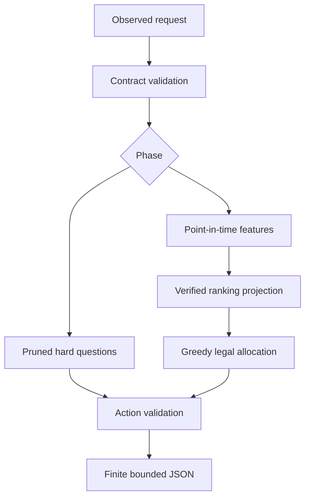

# v0.8 architecture

An offline modular monolith keeps the assessed restart-per-call policy separate from training, observation storage, experiment orchestration and optional solvers. The serving path uses only the Python standard library.

Hard feasibility, availability, no repeats, disjoint endpoints and question/payload budgets are independent of learned scores. The raw65 symmetric /76 directional transform is unchanged. Ranking projections have 36 full, 32 reference or16 reference/no-postdate inputs. IDs join/cache records but never become learned features. Bounded sigmoid ranking nudges are not calibrated MSMI probabilities.

The control plane verifies archived datasets and unchanged label/feature code, builds observed equal-score contrasts, groups whole seeds and publishes immutable JSON bundles. It freezes one pilot candidate before fresh independent final worlds. Atomic deployment pointers keep conservative active.

SQLite transactions, owner tokens, heartbeats, append-only attempts and OS-held locks support one local filesystem. This is not a multi-host queue. Two workers and single numerical threads share one explicit build deadline. Partial/failing matrices remain incomplete.

Trusted in-process episodes pin verified asset bytes and use a bounded20,000-entry public hard-check cache. Request-prepared fingerprints include all inputs read by eligibility; updated hard observations invalidate entries. Availability, repeated pairs and final legality stay live. Copies prevent result mutation, the entry bound clears memory, and context exit discards the cache. CLI/subprocess serving remains uncached. Complete cold/cached preparation action parity is required.

The official simulator is unchanged. Docker recipes contain serving modules only; actual sandbox execution, Windows, hosted CI and external attestation remain separate evidence. Full executable/protocol hashes bind current measurements, and package hashes cover documents and historical evidence too.
